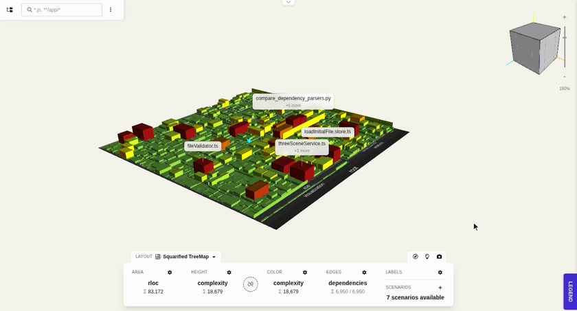
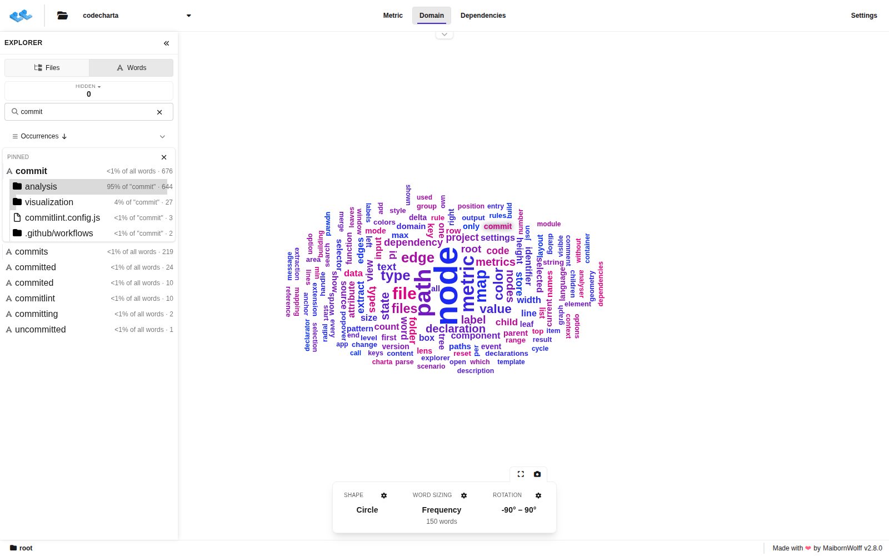
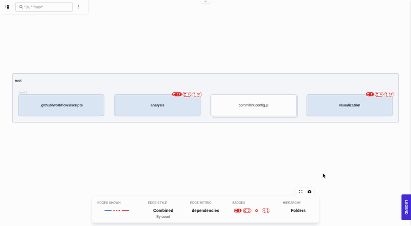
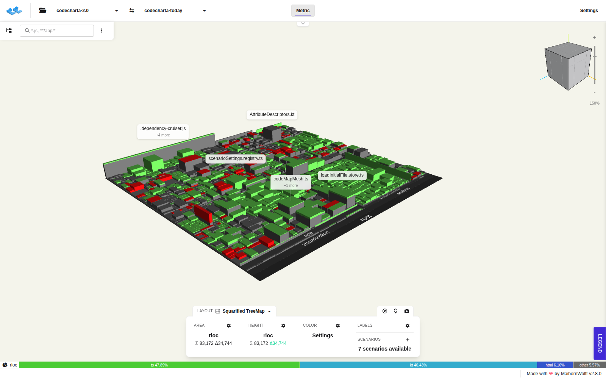

<div align="center">
  <a href="https://codecharta.com/visualization/app/index.html?file=codecharta_visualization.cc.json.gz&file=codecharta_analysis.cc.json.gz&currentFilesAreSampleFiles=true">
    
  </a>

  <h1>CodeCharta</h1>

  <h3>See how your code is built, and what it is about.</h3>

  <p>
    CodeCharta turns any codebase into a 3D city of metrics, a map of its domain language and a graph of its dependencies.<br>
    Find the hotspots in minutes, and show your team what you mean instead of explaining it.
  </p>

  <p>
    <a href="https://codecharta.com/visualization/app/index.html?file=codecharta_visualization.cc.json.gz&file=codecharta_analysis.cc.json.gz&currentFilesAreSampleFiles=true"><b>▶ Try the live demo</b></a> •
    <a href="https://codecharta.com/stg/visualization/index.html?file=codecharta_visualization.cc.json.gz&file=codecharta_analysis.cc.json.gz&area=rloc&height=functions&color=sonar_complexity&edge=dependencies&currentFilesAreSampleFiles=true">Staging demo</a> •
    <a href="#quickstart">Quickstart</a> •
    <a href="https://codecharta.com/docs/overview/introduction">Documentation</a> •
    <a href="https://github.com/MaibornWolff/codecharta/releases">Releases</a>
  </p>

  <p>
    <a href="https://github.com/MaibornWolff/codecharta/releases/tag/ana-2.1.0">
      </a>
    <a href="https://github.com/MaibornWolff/codecharta/releases/tag/vis-2.9.0">
      </a>
    <a href="https://github.com/MaibornWolff/codecharta/tree/ana-2.1.0">
      </a>
    <a href="https://github.com/MaibornWolff/codecharta/tree/vis-2.9.0">
      </a>
    <br>
    <a href="https://sonarcloud.io/dashboard?id=maibornwolff-gmbh_codecharta_analysis">
      </a>
    <a href="https://sonarcloud.io/dashboard?id=maibornwolff-gmbh_codecharta_visualization">
      </a>
    <a href="LICENSE.md">
      </a>
    <br>
    <a href="https://codecharta.com/visualization/app/index.html?file=codecharta_visualization.cc.json.gz&file=codecharta_analysis.cc.json.gz&currentFilesAreSampleFiles=true">
      </a>
    <a href="https://codecharta.com/stg/visualization/index.html?file=codecharta_visualization.cc.json.gz&file=codecharta_analysis.cc.json.gz&area=rloc&height=functions&color=sonar_complexity&edge=dependencies&currentFilesAreSampleFiles=true">
      </a>
  </p>
</div>

## Three views of one codebase

### 🏙️ Metric view: find the hotspots

Every file is a building. You pick what **area**, **height** and **color** mean: lines of code, complexity,
number of commits, number of authors, function length and dozens more. The files that need your attention
stick out of the skyline.

- **Hotspots:** big + tall + red = large, complex and changed all the time
- **Knowledge silos:** color by number of authors to find code only one person understands
- **Temporal coupling:** edges connect files that always change together, even without an import
- **Filter and focus:** search, flatten or exclude files, also by rule like `complexity > 50`
- **Scenarios:** built-in and saved presets for complexity, code smells, authors and more
- **3D print:** export the city as a 3D model and put your codebase on the table

<p align="center">
  
</p>
<p align="center"><sub>Hover a building to see its values and dependencies, select it for all its metrics, focus a folder to zoom in.</sub></p>

### 🔤 Domain view: read what the code is about

The domain language parser reads identifiers, comments and strings, filters out keywords and technical noise, and
scores every word by frequency and **TF-IDF**. The result is the vocabulary of your business, not of your framework.

- **Word cloud per folder:** pick any file or folder and see the words it is written in
- **Where does a word live?** Open a word and get its breakdown over the file tree
- **Phrases, not just words:** bigrams like `commit hash` or `merge commit`
- **Jump between views:** from any node, *Show in Metrics* or *Show in Domain*

<p align="center">
  
</p>
<p align="center"><sub>Where does "commit" live? 95% in <code>analysis</code>, where the git log parser is.</sub></p>

### 🔗 Dependencies view: see the structure

The dependency parser reads the imports of your code, and the graph stacks every folder by level: what a box depends
on lies below it. In a cleanly layered codebase every edge points down, so the ones that don't stand out.

- **Cycles and upward dependencies:** red edges and badges mark what breaks the layering
- **Open what you need:** double-click a folder to see its contents, a file to see its declarations
- **Uses and used by:** select a box and the inspector lists its dependencies in both directions
- **Folders or packages:** arrange the graph by folder or by the packages the code declares

<p align="center">
  
</p>
<p align="center"><sub>Open a folder, hover a box to see its edges, select it to see what it uses and what uses it.</sub></p>

### 📈 Compare: see what changed

Load two versions and compare them. Green grew, red shrank, and you see where the work actually happened.

<p align="center">
  
</p>

## Quickstart

**1. Install the CodeCharta Shell** (Node ≥ 22.19 and Java 22 or newer)

```bash
npm i -g codecharta-analysis
```

**2. Analyse your project**

```bash
cd my-project
ccsh analyse    # opinionated selection of parsers and options to get started, merged into my-project.cc.json.gz
```

Want more control? Run the parsers one by one and merge their results:

```bash
ccsh unifiedparser . -o metrics.cc.json.gz                   # size, complexity, functions
ccsh gitlogparser repo-scan --repo-path . -o git.cc.json.gz  # commits, authors, coupling
ccsh domainlanguageparser . --ngrams=2 -o domain.cc.json.gz  # domain words and phrases
ccsh dependencyparser . -o deps.cc.json.gz                   # imports, cycles, layering
ccsh merge metrics.cc.json.gz git.cc.json.gz domain.cc.json.gz deps.cc.json.gz -o my-project.cc.json.gz
```

Not sure which command you need? `ccsh` without arguments suggests the analysers that fit the current folder, and
`ccsh -i` walks you through any command step by step.

**3. Open it** in the [Web Studio](https://codecharta.com/visualization/app/index.html) with the folder button
(**Load cc.json files**).

Prefer Docker or the desktop app? See [Getting started](https://codecharta.com/docs/overview/getting-started).

## Keep it in shape

`ccsh gate` checks a project against your own limits per metric and against its dependency rules, and fails the build
when one breaks. Run it in CI, in a git hook or after an AI agent. The gate is experimental; see the
[quality gate](https://codecharta.com/docs/analysis/quality-gate).

## Your data stays local

All analysis and visualization run **entirely on your machine**. Nothing is uploaded, shared or sent anywhere.
There is no analytics, tracking or telemetry.

## What CodeCharta can read

| | |
| --- | --- |
| **Source code** | [Unified parser](https://codecharta.com/docs/parser/unified): Java, Kotlin, TypeScript, JavaScript, Python, C#, C, C++, Go, Rust, PHP, Ruby, Swift, Objective-C, Vue, Bash, Delphi, Angular templates, SQL |
| **Dependencies** | [Dependency parser](https://codecharta.com/docs/parser/dependency): imports between files, cycles and upward dependencies |
| **Domain language** | [Domain language parser](https://codecharta.com/docs/parser/domain-language): words and phrases with frequency and TF-IDF |
| **Version control** | [Git log](https://codecharta.com/docs/parser/git-log), [SVN log](https://codecharta.com/docs/parser/svn-log) |
| **Any text** | [Raw text](https://codecharta.com/docs/parser/raw-text): indentation levels for any language |
| **Your other tools** | [SonarQube](https://codecharta.com/docs/importer/sonar), [Coverage](https://codecharta.com/docs/importer/coverage), [Tokei](https://codecharta.com/docs/importer/tokei), [Code Maat](https://codecharta.com/docs/importer/code-maat), [SourceMonitor](https://codecharta.com/docs/importer/sourcemonitor), [CSV](https://codecharta.com/docs/importer/csv) |

[Merge](https://codecharta.com/docs/filter/merge-filter) any combination into one map,
[reshape](https://codecharta.com/docs/filter/structure-modifier) its folder tree, or
[export it to CSV](https://codecharta.com/docs/exporter/csv).

## Get involved

Found a **bug**, have a **feature request** or a question? Please open [a new issue](https://github.com/MaibornWolff/codecharta/issues/new).
Feedback is always welcome, and so are pull requests: start with the [contributing guide](dev_docs/CONTRIBUTING.md).

## Service Offerings

Your company needs professional support to analyse your code base? We offer a service to help you with that.

### Software Health Check

A full Software Health Check for your codebase and everything around it. **Click** the link to learn
more: [Software Health Check](https://www.maibornwolff.de/en/software-health-check/)

## Links

- [Documentation](https://codecharta.com/docs/overview/introduction)
- [Getting started](https://codecharta.com/docs/overview/getting-started)
- [Examples](https://codecharta.com/examples)
- [Releases](https://github.com/MaibornWolff/codecharta/releases)
- [Analysis - Changelog](analysis/CHANGELOG.md) | [Visualization - Changelog](visualization/CHANGELOG.md)
- [Contributing](dev_docs/CONTRIBUTING.md)
- [Code of Conduct](dev_docs/CODE_OF_CONDUCT.md)
- [Dev Start Guide](dev_docs/DEV_START_GUIDE.md)
- [License](LICENSE.md)

## License

BSD-3-Clause License

---

Made with ❤ by [MaibornWolff](https://www.maibornwolff.de/en) &nbsp;&middot;&nbsp; GitHub [@MaibornWolff](https://github.com/maibornwolff)
